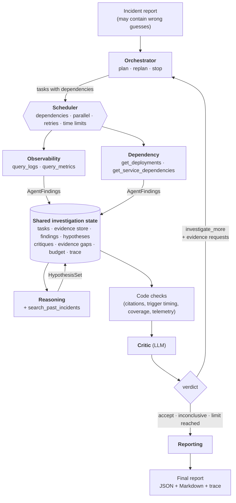
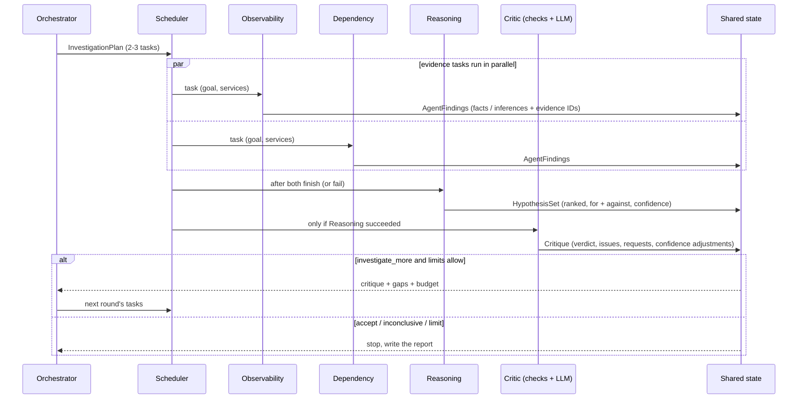

# Architecture

The system investigates a production incident with six agents that coordinate through a
**shared investigation state**. Evidence is gathered in **parallel**, competing
hypotheses are formed, and a **Critic** challenges them. The Critic is part code, part
LLM, and it can send the team back for more evidence. When the Critic is satisfied, or a
limit is reached, a **report** is written.

## Components

### One round, in time order

## The six agents

| Agent | Tier | Tools | Reads from the state | Writes to the state |
|---|---|---|---|---|
| Orchestrator | fast | none | incident, service catalog, tasks so far, hypotheses, latest critique, gaps, budget used | `InvestigationPlan`: up to 3 tasks, or `stop` |
| Observability | fast | `query_logs`, `query_metrics` | its task, evidence already held | `AgentFindings` |
| Dependency | fast | `get_deployments`, `get_service_dependencies` | its task, evidence already held | `AgentFindings` |
| Reasoning | strong | `search_past_incidents` | all findings, evidence digest, gaps, previous hypotheses, critique | `HypothesisSet` |
| Critic | strong | none | hypotheses, **code check results**, findings, evidence, gaps, round number | `Critique` |
| Reporting | fast | none | final hypotheses, last critique, checks, findings, evidence, gaps, stop reason | `FinalReport` |

"fast" and "strong" are **tiers**, not vendors. In the evaluation both point to the same model, so that the
comparison measures the architecture (see [EVALUATION.md](EVALUATION.md)).

### Why this is collaboration and not a prompt chain

- **Typed messages only.** Every agent output is a Pydantic model (`models.py`), validated on the way in.
  Invalid output gets one repair attempt that shows the model the validation errors.
- **The state is the only channel.** Agents never see each other's transcripts. The Reasoning agent sees
  findings and a one-line-per-item evidence digest, not 40k tokens of raw tool output.
- **Work can flow backwards.** The Critic's `EvidenceRequest`s become new tasks; the Orchestrator merges,
  prunes or extends them. The number of rounds depends on what is found.
- **The plan adapts.** Round 2's tasks depend on round 1's hypotheses and the Critic's objections.

## Evidence IDs: how grounding is enforced

Every item a tool returns carries an ID: a log line `log-00412`, a metric `metric:ledger-db:disk_used_pct`,
a change `chg-1042`, an edge `dep:payments-api->upi-gateway`, a past incident `hist-2026-0722`. The executor
records each item in the **evidence store** with who retrieved it. Findings, hypotheses and the report must
cite these IDs. Two consequences:

1. The **code checks** can tell when a hypothesis cites evidence that was never retrieved, or blames a change
   whose timestamp is after the symptom onset.
2. The **evaluation** measures citation validity (cited IDs really retrieved) and key-evidence recall
   (did the report cite the evidence that proves the answer) without an LLM judge.

## The Critic: code checks, then an LLM, and the code can veto

`agents/checks.py` runs before the Critic LLM and its results go into the Critic's prompt:

| Check | Example |
|---|---|
| Citations exist | "H2 cites evidence never retrieved: [log-99999]" |
| Trigger precedes onset | "H1's trigger chg-9369 is at 14:00, AFTER the symptom onset 13:52" |
| Top suspect observed | "no logs or metrics of ledger-db (top hypothesis H1) were retrieved" |
| Symptomatic telemetry present | "notification-service's own metrics could not be retrieved (tool failures)" |
| Ranking settled | "H1 and H2 are within 0.15 confidence" |
| Gaps on the suspect | tool failures that touched the top suspect |

**Why a veto:** in live runs the LLM Critic sometimes accepted a hypothesis that had failed one of these
checks. So if a *blocking* check fails on the top hypothesis and rounds remain, the harness overrides
"accept" with "investigate_more" and adds the missing check as a request. The blocking checks are: trigger
after onset, no supporting evidence, unknown service, suspect never observed, and missing symptomatic
telemetry. If a blocking check is still open when the investigation ends, the report's verdict becomes
**inconclusive** and the open check is listed as an evidence gap.

## Scheduler

`harness/scheduler.py` runs one round's tasks as a small dependency graph:

- Evidence tasks have no dependencies and run **concurrently** (up to 3 at once).
- Reasoning `depends_on` the evidence tasks: it waits for them to finish **whatever the outcome**, so one
  failed specialist does not block the round.
- The Critic `requires` Reasoning: if Reasoning failed, there is nothing to critique and the task is skipped.
- Each attempt has a time limit (180 s). A failed or timed-out task is retried once, then marked failed and
  recorded as an evidence gap.
- `BudgetExceeded` cancels running tasks and ends evidence gathering. The report is still written.

Inside an agent, several tool calls requested in one model turn also run concurrently (`asyncio.gather`).

## Stop conditions

Checked after every round (`multi_agent.py`):

1. The Critic accepts (after the code veto), or says the evidence cannot settle it (**inconclusive**).
2. The round limit is reached (3). In the last round "investigate_more" turns into "inconclusive".
3. A round produced **no new evidence**: another round would repeat itself.
4. The Orchestrator returns `stop` or no tasks.
5. The **budget** runs out (checked before every LLM and tool call): 40 tool calls, 30 LLM calls, 250k tokens
   or 600 s. The Reporter has a reserve (2 calls, 30k tokens), so a report is always produced.

## Failure handling

| Failure | Handling |
|---|---|
| Tool timeout / 503 | Executor retries with backoff (3 attempts, each counted as a tool call), then returns a structured error the agent can act on; recorded as an evidence gap |
| Tool returns partial data | Result marked `partial` with a note ("results INCOMPLETE"); recorded as a gap |
| Bad tool arguments | Structured, non-retryable error naming the valid values; the model corrects itself |
| LLM 5xx / network | Client retries twice (2 s, 5 s) |
| LLM 429 | Router waits (bounded) and retries, then **falls back to the next provider**. A provider whose daily quota is gone is skipped from then on |
| Invalid structured output | One repair turn with the validation errors |
| Agent task crash / timeout | Retried once; then failed and recorded as a gap; the round continues |
| Orchestrator fails | Default plan by code (symptomatic services + recent changes), or the Critic's requests turned into tasks |
| Reporting fails | Report assembled by code from the shared state |
| Budget exhausted | Gathering stops; Reporter uses the reserve |

## Tools and simulated failures

Five tools (`tools/catalog.py`) with Pydantic input models (these are also the JSON schemas the LLM sees):
`query_logs`, `query_metrics`, `get_deployments`, `get_service_dependencies`, `search_past_incidents`.
They summarise the way real observability tools do: log **patterns** with counts and first-seen times,
metric **baselines, anomaly onsets and saturation**, so agents spend tokens on reasoning, not on scrolling.

`tools/executor.py` injects failures in two ways:

- **Scripted**, per incident (`faults.json`): e.g. the first 3 metric calls for a service time out, or a
  service's metrics are permanently unavailable.
- **Random**, at a seeded rate (default 5%). The draw is a hash of (seed, tool, arguments, attempt), so the
  same call fails the same way on every run, whatever order the parallel agents run in.

Modes: `timeout` (the call exceeds its time limit), `error` (503), `partial` (shards missing, half the
metrics, first page only, shallow graph).

## LLM layer

- `llm/client.py`: plain HTTP against any OpenAI-compatible API (Gemini, Groq). Tool calling plus strict
  JSON-schema output. Gemini's thought signatures on tool calls are echoed back; they are stripped for
  other providers.
- `llm/router.py`: agents ask for a **tier**. The router checks the budget, serves cached answers, waits on
  rate limits, falls back across providers, and records tokens and a trace span for every call.
- `llm/cache.py`: SQLite, keyed by the exact request. It makes re-runs and resumed evals free. It is
  switched off for the final evaluation, so latency is real.
- `harness/context.py`: the run's **budget** and **tracer**. Spans nest through a contextvar, so the trace
  shows `run → task → agent → llm/tool` even across parallel tasks. Each run writes `trace.jsonl`.

## Facts, assumptions, inconclusive

- Findings are labelled `fact` (directly shown by cited evidence) or `inference`.
- Hypotheses list `assumptions` and their `contradicting` evidence.
- The report has separate `facts`, `assumptions` and `evidence_gaps` sections.
- **Inconclusive** is a first-class outcome. It is chosen when the Critic says so, when a blocking check is
  still open, when the top confidence is below 0.4, or when there are no hypotheses. The same final rule
  (no hypotheses or top below 0.4 → inconclusive) is applied to the baseline.

## Single-agent baseline

`baseline.py`: one agent with **all five tools**, the same budget, the same report schema, the same domain
principles in its prompt, and the same final verdict rule. It runs one tool loop (up to the budget's 40 tool
calls), then writes the report. No specialists, no shared state between steps, no Critic, no feedback loop,
no code checks.

## Code map

| Path | Responsibility |
|---|---|
| `models.py` | All typed messages between agents |
| `world.py` | Loads one incident's synthetic world (never the ground truth) |
| `tools/catalog.py`, `tools/executor.py` | Tools; failure injection, retries, evidence registration |
| `harness/context.py` | Budget, tracer, evidence store |
| `harness/state.py`, `harness/scheduler.py` | Shared state; dependency-aware parallel task runner |
| `agents/base.py` | The tool loop + structured answer every agent runs |
| `agents/orchestrator.py`, `agents/specialists.py`, `agents/reporting.py` | The six agents |
| `agents/checks.py` | Code checks and the blocking rules |
| `agents/prompts.py` | System prompts (generic: no incident-specific content) |
| `llm/` | Client, router, cache, schema conversion, scripted fake for tests |
| `multi_agent.py`, `baseline.py` | The two systems |
| `eval/` | Scoring against ground truth, runner, summary |
| `dataset/` | Scenario specs and the generator for `data/` |
